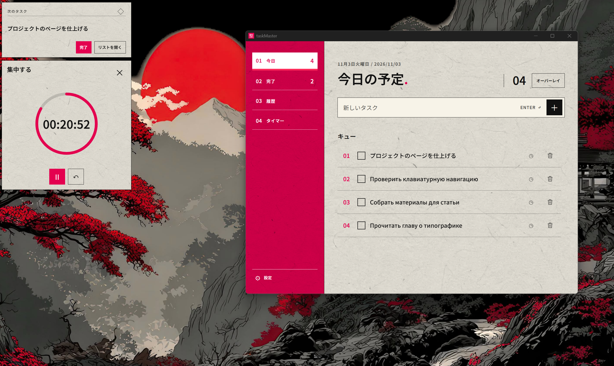
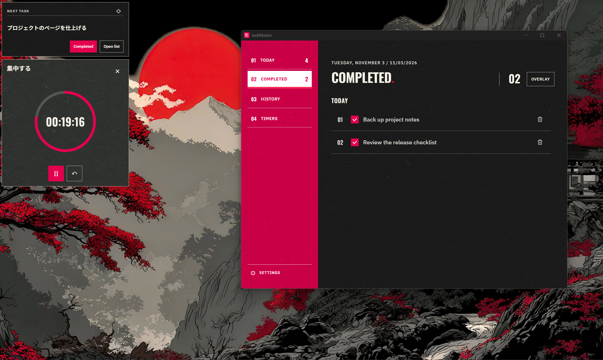
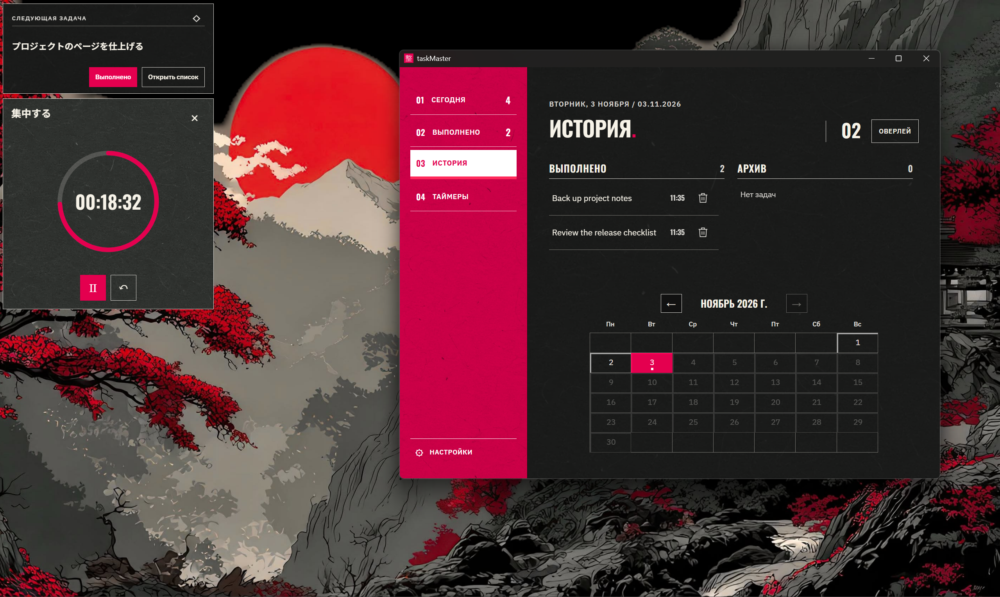
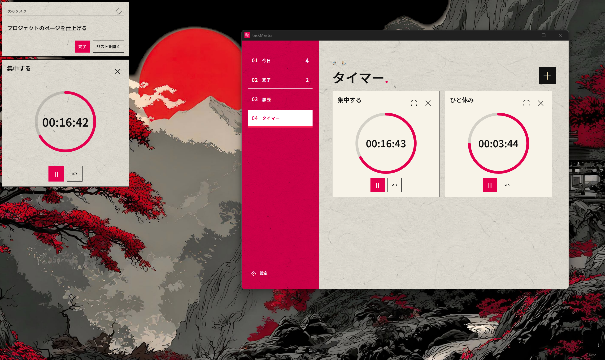
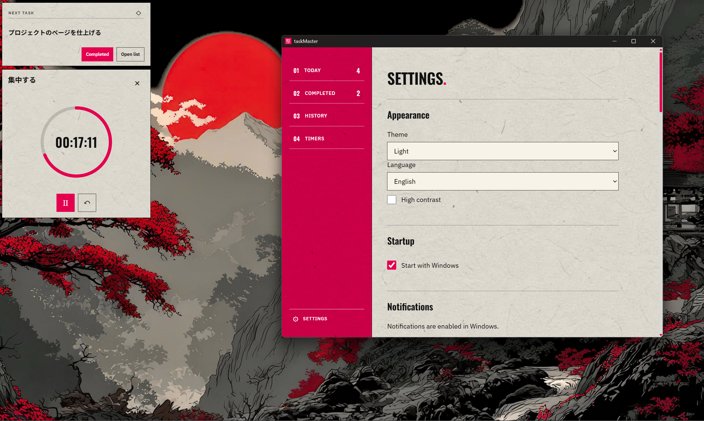
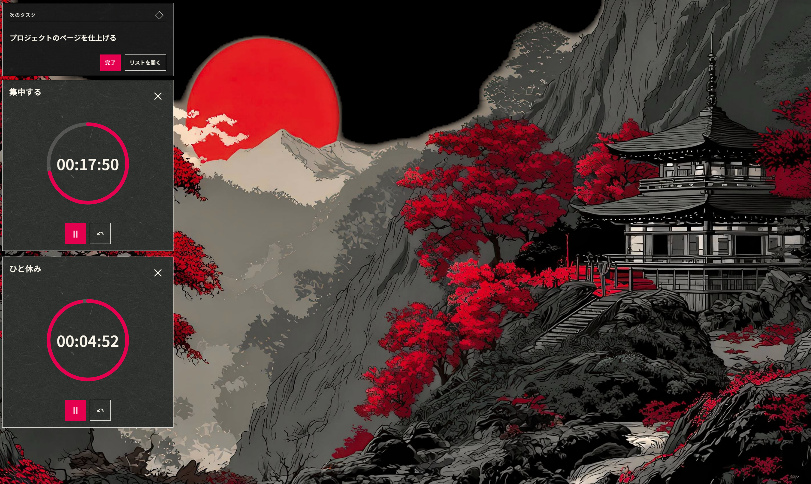

<p align="center">
  
</p>

# taskMaster

Локальный менеджер задач для Windows, который помогает сосредоточиться на делах текущего дня. Расставляйте задачи в удобном порядке, задавайте напоминания и запускайте независимые таймеры. Оверлей держит ближайшую задачу и таймеры поверх других окон, а история сохраняет выполненные и архивные дела. Данные хранятся на вашем компьютере; приложение работает без интернета, аккаунтов и телеметрии. Доступны русский, английский и японский интерфейсы, светлая и тёмная темы.

[Установка](#установка) · [Сборка](#сборка-из-исходников) · [Участие](#участие-в-разработке)

## Скриншоты



<details>
<summary>Другие разделы, языки и темы</summary>

| Выполнено · English · тёмная тема | История · Русский · тёмная тема |
| --- | --- |
|  |  |
| Таймеры · 日本語 · светлая тема | Настройки · English · светлая тема |
|  |  |



</details>

## Установка

Требуется Windows 10 или новее (x64) и [Microsoft Edge WebView2 Runtime](https://developer.microsoft.com/microsoft-edge/webview2/).

1. Откройте [Releases](https://github.com/TAskMAster339/taskMaster/releases).
2. Выберите опубликованный релиз и скачайте MSI из **Assets**.
3. Запустите установщик и откройте **taskMaster** из меню «Пуск».

Файл `.exe` из Assets позволяет запускать приложение без установки; для интеграции уведомлений Windows используйте MSI.

При первом запуске интерфейс японский. Сменить язык можно в **設定 → 言語**. Напоминания работают, пока приложение запущено, включая работу в трее. Подробности об архиве, горячих клавишах и резервных копиях — в [руководстве](docs/BEHAVIOR.md).

## Сборка из исходников

Установите [Git](https://git-scm.com/downloads/win), [Node.js 24](https://nodejs.org/), [Rust](https://rustup.rs/) со stable MSVC toolchain и [C++ Build Tools с Windows SDK](https://v2.tauri.app/start/prerequisites/#windows). Нужен также WebView2 Runtime.

В PowerShell:

```powershell
git clone https://github.com/TAskMAster339/taskMaster.git
cd taskMaster
npm ci
.\scripts\Start-TaskMaster.ps1 -Dev
```

Чтобы собрать самостоятельный исполняемый файл:

```powershell
.\scripts\Start-TaskMaster.ps1 -BuildOnly
```

Результат: `src-tauri\target\release\taskmaster.exe`. Для сборки установщика:

```powershell
npm run tauri -- build --bundles msi
```

MSI появится в `src-tauri\target\release\bundle\msi\`. Подробнее о запуске, архитектуре и проверках — в [документации разработчика](docs/DEVELOPMENT.md).

## Участие в разработке

Сообщайте об ошибках и предлагайте улучшения через [Issues](https://github.com/TAskMAster339/taskMaster/issues). Перед первым pull request прочитайте [CONTRIBUTING.md](CONTRIBUTING.md); для AI-агентов дополнительно действуют [AGENTS.md](AGENTS.md) и проектные навыки. Изменения интерфейса опираются на [DESIGN.md](DESIGN.md).

## Лицензия

Код проекта распространяется под [MIT](LICENSE). Сторонние шрифты сохраняют собственные лицензии в [frontend/public/fonts](frontend/public/fonts).

---

Автор — [TAskMAster339](https://github.com/TAskMAster339) · [Персональный сайт](https://taskmaster339.github.io/).
